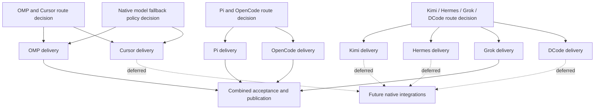

# Portable agents: native parity across supported harnesses

Status: implementation and isolated native qualification; canonical status below.
Canonical task status: [GitHub milestone](https://github.com/archeism/plugnz/milestone/2).
Canonical decision map: [Map native portable-agent parity across supported harnesses](https://github.com/archeism/plugnz/issues/91). The [local task index](todo.md) contains links, not duplicate status.
The previous [distributor plan](archive/distributor/plan.md) and [issue index](archive/distributor/todo.md) are preserved; their milestone is closed with zero open issues.

## Outcome and fixed contract

This increment extends portable agent definitions and deterministic model selection to OMP, OpenCode and Grok Build. Pi is an explicit owner-approved exception: loudly warn and ignore portable agents without failing, not a native parity claim ([decision](https://github.com/archeism/plugnz/issues/101#issuecomment-6346092250)). Charles subsequently deferred Cursor, Kimi, Hermes and DCode; their open delivery issues remain TODOs, not support claims. Preserve the qualified Claude Code, Codex and ZCode CLI baseline at `bda34a0390667ed3ca32635f29d0bd35256eb5a9` (released as 0.0.31).

Use the [existing authoring contract](../docs/portable-agents.md): one name, description and prose body; optional alias and explicit destination mapping. Explicit mapping wins over user alias, then package alias; absent mapping omits the native model field. `fast` and `smart` are naming conventions, not automatic provider guesses. Native tools remain the harness's responsibility. Do not add tool/permission preferences, a daemon, ACP execution or another agent runtime.

A native agent is a definition the harness can discover and execute as a child. A copied resource or parser result is insufficient. Exact supported versions and lifecycle limitations are part of each support claim. Unsupported/unverified targets remain visibly blocked; only Charles can accept a scope reduction.

## Dependency graph

The tracker contains the actual native blocking edges. Three route decisions and one human model-policy decision are child issues of the map; delivery issues live in the same milestone. Closing the map does not close delivery. Research may establish that a grouped decision needs smaller child decisions; split then, rather than prematurely pretending a missing route is supported. When one host route resolves before its siblings, split the unresolved decisions and retarget the native blocker edges before starting that host delivery.

## Ordered task index

### Route decisions

1. [Choose native agent registration for OMP and Cursor](https://github.com/archeism/plugnz/issues/92)
2. [Choose native agent registration for Kimi, Hermes, Grok Build and DCode](https://github.com/archeism/plugnz/issues/93)
3. [Decide native agent routes for Pi and OpenCode without a custom runtime](https://github.com/archeism/plugnz/issues/94)
4. [Remaining Cursor native route](https://github.com/archeism/plugnz/issues/105), split from #92.
5. [Pi existing-extension decision](https://github.com/archeism/plugnz/issues/106), resolved by owner deferral.

Each uses first-party source and current adapter evidence. Research does not execute paid models or mutate live installations. A decision resolution names the route, supported surface, remaining runtime proof and next bounded probe. Unresolved evidence stays open. Claim while working; release unfinished claims when ending a session.

### Human decision exposed by research

[Decide how explicit model mappings respect native fallback policy](https://github.com/archeism/plugnz/issues/104)

Charles chose [preserve native model policy](https://github.com/archeism/plugnz/issues/104#issuecomment-6345606404): pass the exact resolved value and disclose native credential/account/admin substitutions. He also [approved native Markdown parsing](https://github.com/archeism/plugnz/issues/104#issuecomment-6346091818): preserve generated prose, disclose native normalization, and verify meaningful instructions in actual child requests. Neither decision changes mapping precedence or omission.

### First delivery checkpoint

1. [Portable agents: deliver native OMP integration](https://github.com/archeism/plugnz/issues/95)

Cursor (#96/#105) is explicitly deferred without adapter changes. Its plugin loader strips agent model fields; the separate P-stack convention supplies a model in the parent's runtime Task call rather than preserving install-time mappings.

### Remaining plugin adapters

1. [Portable agents: deliver native Kimi integration](https://github.com/archeism/plugnz/issues/97)
2. [Portable agents: deliver native Hermes integration](https://github.com/archeism/plugnz/issues/98)
3. [Portable agents: deliver native Grok Build integration](https://github.com/archeism/plugnz/issues/99)
4. [Portable agents: deliver native DCode integration](https://github.com/archeism/plugnz/issues/100)

Grok Build proceeds through its native plugin-agent loader. Kimi, Hermes and DCode were explicitly deferred after source/native investigation: Kimi Code 2.1.1 discovers plugin agents but has no agent-file model field; Hermes has no named-agent registrar or per-agent model selector; DCode excludes agents from plugin discovery and its separate user agent store is assistant-scoped. Keep these TODOs open and their adapters unchanged.

### Extension scope checkpoint

1. [Portable agents: warn and skip Pi without failing](https://github.com/archeism/plugnz/issues/101)
2. [Portable agents: deliver native OpenCode integration](https://github.com/archeism/plugnz/issues/102)

OpenCode uses its native plugin configuration hook and existing owned package lifecycle; native child execution remains a qualification requirement. Pi retains existing hook support and ignores portable agents with an explicit non-failing warning. Neither change admits standalone skill/command distribution or a custom delegation runtime.

### Final checkpoint

[Accept portable-agent parity and publish the support matrix](https://github.com/archeism/plugnz/issues/103)

Current acceptance covers three native integrations (OMP, OpenCode, Grok Build) and Pi's owner-approved warning/skip behavior. Cursor, Kimi, Hermes and DCode remain open deferred TODOs outside this increment. Do not claim the original eight-target parity milestone is complete. Publish verified work via existing exact-SHA CI gates; fleet rollout is separate.

## Per-delivery verification

The detailed acceptance checklists live in the delivery issues. Common checks are:

- Public installation, native discovery and actual child execution with exact prose, model precedence/omission and normal native tools.
- Isolated install, unchanged re-add, same-version content update, alias-only update, rename/removal, failed update/rollback, collision refusal and preservation of unrelated configuration.
- Versioned capability evidence, source pins, native transcripts and a merged commit; independent review, focused tests, typecheck and build. Full regression at integration checkpoints, not repeated for each exploratory probe.

Use local deterministic provider fixtures when feasible. Record wall time, tokens/cache and resources together; unknown metrics remain unknown. Budget disk before native probes. A successful command exit is not proof of native semantics.

## Risks and open decisions

| Risk | Gate |
| --- | --- |
| Native subagent primitives differ or do not exist | Source-backed route decision; leave missing capability blocked |
| Alias/model omission behaves differently | Capture actual child model selection, including absent mapping |
| Native refresh overwrites projections or leaves stale roles | Existing Codex regression floor plus host-specific lifecycle proof |
| Hook-only targets require scope expansion | Resolve route/scope explicitly before adapter work |
| Tool restriction semantics leak into the basic abstraction | Preserve native defaults; [existing deferred issue](https://github.com/archeism/plugnz/issues/89) stays outside scope |

The user has already settled the basic contract and requested milestone governance. Exact native route feasibility is research work, not a question to return to the user. New product tradeoffs revealed by research become named decision tickets.

## Session evidence

The original planning checkpoint verified milestone membership and blocking edges. Subsequent owner scope decisions above supersede its eight-delivery acceptance graph. Versioned native execution evidence lives under `docs/evidence/`; research alone is not delivery proof. Skills remain unchanged: no skill-improvement claim.

## Bounded research assets

- [OMP and Cursor](../docs/research/portable-agent-parity-20261022/omp-cursor.md): native package candidates, with model-policy qualifications still open.
- [Kimi, Hermes, Grok Build and DCode](../docs/research/portable-agent-parity-20261022/plugin-hosts.md): source-backed candidate routes and unresolved loader/registration gaps.
- [Pi and OpenCode](../docs/research/portable-agent-parity-20261022/extensions.md): OpenCode native config-hook candidate; Pi requires an explicit extension-route decision.

These are source investigations, not native execution evidence. Research tickets stay open where decisions are unresolved; no implementation is marked ready by report completion alone. Independent planning review checked scope, acceptance gates and archival preservation; its grouping recommendation is included above. Skills unchanged.
